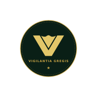
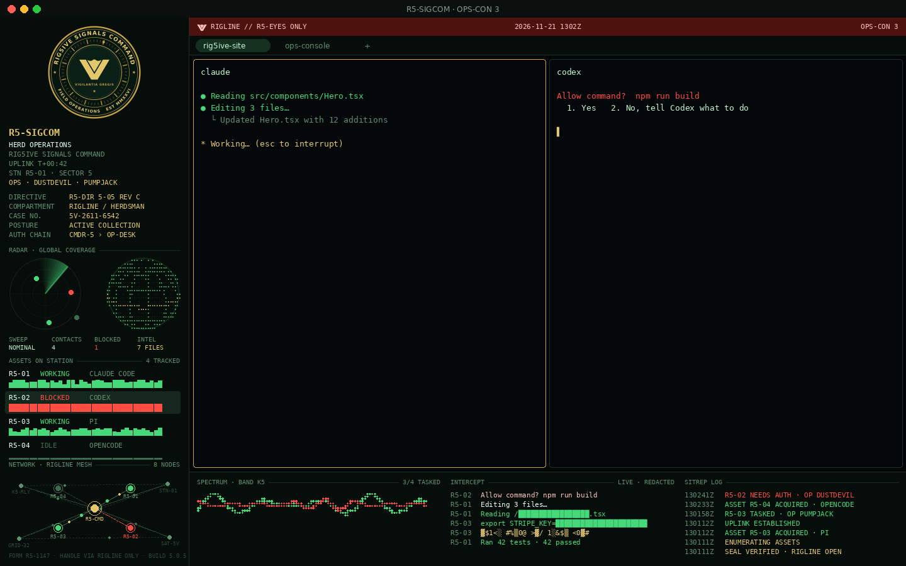
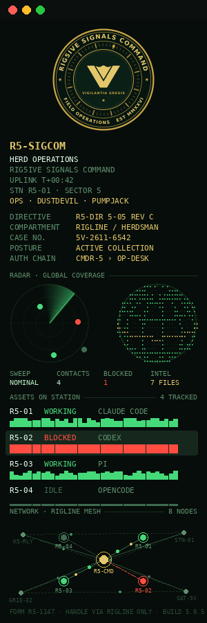
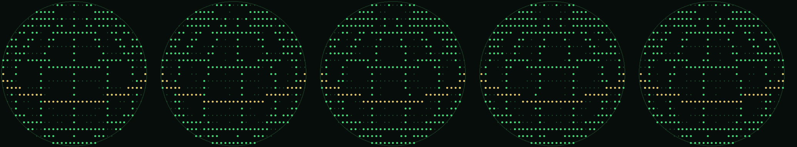
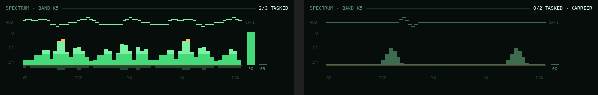
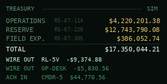

<div align="center">



# R5-SIGCOM

**Rig5ive Signals Command — a signals-intelligence ops terminal for the Herdr desktop app**

`CLASSIFICATION: UNCLASSIFIED // FICTIONAL` · `DIRECTIVE R5-DIR 5-05 REV C` · `COMPARTMENT RIGLINE / HERDSMAN`



</div>

---

R5-SIGCOM turns Herdr into an intelligence-agency style operations floor, modeled on the look of an NSA-style signals terminal: seals, radar sweeps, intercept feeds, spectrum analyzers and dossiers. Every moving part is driven by your real AI agents. When an agent works, the floor lights up. When one needs your approval, the console goes red.

The agency is fictional. The telemetry is real.

## Contents
- [Operating states](#operating-states)
- [Command rail (left)](#command-rail-left)
- [Signals floor (bottom)](#signals-floor-bottom)
- [Dossier panel (right)](#dossier-panel-right)
- [Field controls](#field-controls)
- [Install](#install)
- [Operational security](#operational-security)
- [Disclaimer and credits](#disclaimer-and-credits)

## Operating states

| State | Trigger | What you see |
|---|---|---|
| **DORMANT** | No agents running | Dimmed seal, flat pulsing audio line, "AWAITING TASKING" banner |
| **BOOT** | First agent starts | Six-phase boot sequence: seal verified, uplink established, enumerating assets, RIGLINE open |
| **ACTIVE** | Agents running | Full floor live. The OPS-CON level rises with activity |
| **ALERT** | Any agent blocked | Red banner, pulsing NEEDS AUTHORIZATION, blocked counter on the radar |

The window title and dock badge follow the OPS-CON level.

## Command rail (left)



**Command seal.** Three animated layers: a counter-rotating outer ring lettered RIG5IVE SIGNALS COMMAND, a tick ring, and the Rig5ive emblem at the center. On short screens it switches to a compact seal.

**Identity block.** Agency, station designator, uplink clock (T+ since boot) and the active operation codenames, plus a faux routing card: directive, compartment, case number, posture and authorization chain.

**Radar.** A sweeping scope with one contact per agent, colored by status. Under it: sweep state, contact count, blocked count and intel files collected.

**Global coverage globe.** A green wireframe globe spins beside the radar, drawn as a dot matrix: near-side grid lines bright, far side dim, equator in brass. It turns red when an agent is blocked, slows to a crawl when the platform is dormant and whips around during boot.



**Assets on station.** Each agent gets an asset number (R5-01, R5-02, ...), its status and a live activity meter. Click an asset to open its dossier.

**Network mesh.** A node graph in the lower-left corner. Your agents sit around a central R5-CMD hub, wired to relay stations, with data packets traveling the links. Links go dark when agents go idle.

**Open Browser.** Launches `terminal-browser` in a split if you have it installed.

<br clear="right">

## Signals floor (bottom)


**Spectrum analyzer.** Band K5. Frequency bars with a mirrored reflection, axis and frequency labels. Bar energy follows how many agents are tasked, and blocked agents push red spikes into the band. Per-channel level meters sit on the right.



**Audio trace.** A streaming waveform lane above the spectrum. It idles as a flat pulse and becomes a moving trace when agents start working.

**Intercept.** A live, redacted feed of what your background agents are doing. Secrets are blacked out (█) before display. It reads only busy, non-focused agents every few seconds, so it never slows your typing. Click the header to pause it.

**Treasury.** A faux bank desk with dummy accounts, balances and a scrolling transaction log (wires, ACH, settlements). All numbers are made up.



**GDP readout.** A digital display cycling through national GDP and growth figures, from public World Bank data refreshed once a day.


**SITREP log.** Timestamped Zulu-time situation reports: assets acquired, tasked, blocked and completed.

**Ticker.** A marquee of operation traffic across the top of the work area.

## Dossier panel (right)


Open it from the **Dossier** button in the tab bar, or by clicking an asset. Each agent's file shows:

- the agent's own company logo on a gold-cornered plate
- an asset number and an operation codename (NIGHTJAR, PUMPJACK, DUSTDEVIL, ...)
- a plain-language status alert:

| Alert | Meaning |
|---|---|
| 🔴 **NEEDS AUTHORIZATION** | The agent is waiting for your approval |
| 🟢 **ACTIVE · TASKED** | The agent is working |
| 🟡 **MISSION COMPLETE · REVIEW** | The agent finished and its output is ready |
| ⚪ **STANDING BY** | The agent is idle |

The panel follows the focused agent, or stays pinned to the one you opened.

<br clear="right">

## Field controls

**Right-click a tab:** split right, split down, start a new agent in a split, rename, close.

**Right-click a folder in Files:** start any installed agent in that folder (new tab or split), or reveal it in Finder.

## Install

Agents can build it from scratch with [RECIPE.md](RECIPE.md).

Requires the [Herdr](https://github.com/jerryfane/herdr) desktop app.

1. Download the repo as a zip (Code → Download ZIP) or clone it.
2. Copy `layouts/`, `themes/` and `mods/` into `~/.config/herdr-app/`.
3. Switch to the layout:

```sh
git clone https://github.com/randyellis-wealthberry/r5-sigcom.git
cp -R r5-sigcom/layouts r5-sigcom/themes r5-sigcom/mods ~/.config/herdr-app/
~/.local/bin/herdr-app do layout.switch --name r5-sigcom
```

Best with JetBrains Mono installed.

### What gets installed
```
layouts/r5-sigcom.json    the floor plan
themes/r5-sigcom.json     phosphor green on black, brass accents
mods/r5-sigcom/           the console: rail, floor, dossier, menus
mods/r5-tabs/             tab bar with the right-click menu and Dossier button
mods/r5-files/            file tree with "start agent here"
```

## Operational security

- **One outbound call:** a daily fetch of public GDP figures from `api.worldbank.org`. Nothing about you or your work is sent.
- **Intercept stays local.** Agent screen text is read on your machine, redacted, and displayed. It is never stored or transmitted.
- **Automatic redaction** of API keys, tokens, emails, long hashes and home-folder paths.
- No analytics, no telemetry, no accounts.

## Disclaimer and credits

R5-SIGCOM is a fictional agency created for entertainment. It is **not affiliated with, endorsed by, or a replica of** the NSA, CIA or any government body, and uses no real government seals or insignia. All codes, case numbers, stations and financial figures are invented.

`mods/r5-tabs` and `mods/r5-files` are modified versions of the tabs and files mods that ship with Herdr. Credit for the originals goes to the Herdr authors, under Herdr's license.

Topics: `herdr-layout` `herdr-mod` `herdr-theme`

© 2026 Rig5ive · MIT License for original work (see [LICENSE](LICENSE))
