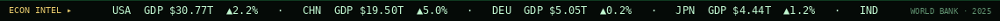
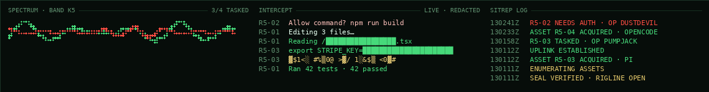
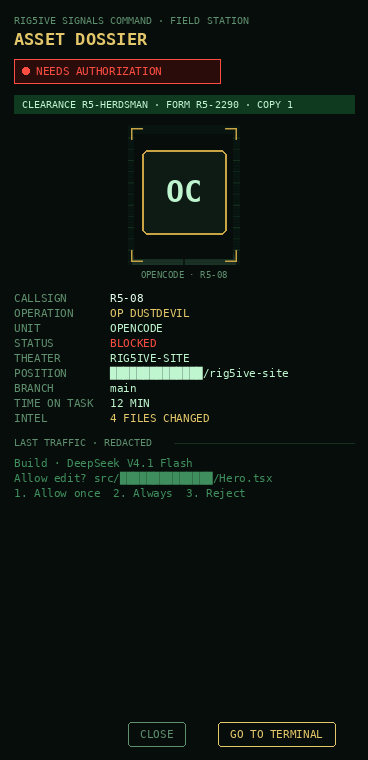

<div align="center">


# R5-SIGCOM

**Rig5ive Signals Command — a signals-intelligence ops terminal for the Herdr desktop app**

Built by [Rig5ive](https://rig5ive.com)

`CLASSIFICATION: UNCLASSIFIED` · `DIRECTIVE R5-DIR 5-05 REV C` · `COMPARTMENT RIGLINE / HERDSMAN`


</div>

---

R5-SIGCOM turns Herdr into an intelligence-agency style operations floor: seals, radar sweeps, intercept feeds, spectrum analyzers and dossiers. Every moving part is driven by your real AI agents. When an agent works, the floor lights up. When one needs your approval, the console goes red.

## Contents
- [Layout](#layout)
- [Operating states](#operating-states)
- [Command rail (left)](#command-rail-left)
- [Banner and ticker (top)](#banner-and-ticker-top)
- [Signals floor (bottom)](#signals-floor-bottom)
- [Dossier panel (right)](#dossier-panel-right)
- [Field controls](#field-controls)
- [Install](#install)
- [Operational security](#operational-security)
- [Disclaimer and credits](#disclaimer-and-credits)

## Layout

```
┌──────────────┬──────────────────────────────────────────────────────────┐
│              │ BANNER  classification · Zulu clock · OPS-CON            │
│   COMMAND    ├──────────────────────────────────────────────────────────┤
│    RAIL      │ TICKER  ECON INTEL ▸ USA GDP $30.77T ▲2.2% · CHN …       │
│              ├──────────────────────────────────────────────────────────┤
│  seal        │ TABS    tab bar · Files · Changes · Dossier              │
│  identity    ├───────────────────────────────────────────┬──────────────┤
│  routing     │                                           │  RIGHT PANEL │
│  radar       │          TERMINALS (your agents)          │  Files       │
│  assets      │                                           │  Changes     │
│  mesh        │                                           │  Dossier     │
│              ├───────────────────────────────────────────┴──────────────┤
│ OPEN BROWSER │ SIGNALS FLOOR  spectrum · intercept · treasury · SITREP  │
└──────────────┴──────────────────────────────────────────────────────────┘
```

The rail (260–420px), right panel (280–900px, hidden until opened) and signals floor (90–320px) can all be resized. The intercept column appears when the floor is wider than 640px, the treasury when it's wider than 1150px.

## Operating states

| State | Trigger | What you see |
|---|---|---|
| **DORMANT** | No agents running | Olive banner (RIGLINE // STANDBY), dimmed seal, flat pulsing carrier, NO ASSETS ON STATION · AWAITING TASKING |
| **BOOT** | First agent starts | Amber banner (HANDSHAKE) and a 3.4-second, six-phase boot: auth, keys exchanged, seal verified, enumerating assets, uplink, platform online |
| **ACTIVE** | Agents running | Green banner (R5-EYES ONLY), full floor live at OPS-CON 5 |
| **ALERT** | Any agent blocked | Red banner, pulsing NEEDS AUTHORIZATION. OPS-CON drops to 3 for one blocked agent, 2 for several, 1 when every agent is blocked |

The window title reads `R5-SIGCOM · OPS-CON n`, and the dock badge shows how many agents are blocked (on desktops that support badges).

## Command rail (left)


**Command seal.** Three animated layers: a counter-rotating outer ring lettered RIG5IVE SIGNALS COMMAND, a tick ring, and the Rig5ive emblem with the motto VIGILANTIA GREGIS. On short screens it switches to a compact seal.

**Identity block.** Agency, station designator, uplink clock (T+ since boot) and the active operation codenames.

**Routing card**. Directive, compartment, case number, posture and authorization chain.

**Radar.** A sweeping scope with one contact per agent, colored by status. Beside it: sweep state, contact count, blocked count, and INTEL, the number of files your agents have changed.

**Assets on station.** Each agent gets a stable asset number (R5-01, R5-02, …), its status, its name and a live activity meter. Blocked rows turn red. Click an asset to open its dossier.

**Network mesh.** Your agents ring a central R5-CMD hub, wired to four relay stations, with packets traveling active links. Links go dark when agents go idle. Fits about 6 agents.

**Open Browser.** Launches `terminal-browser` in a split if you have it installed.

<br clear="right">

## Banner and ticker (top)

**Banner.** Classification text on the left, date and Zulu time in the center, OPS-CON on the right. Its color follows the operating state.

**Ticker.** ECON INTEL: a marquee of national GDP and growth figures (USA, CHN, DEU, JPN, IND, GBR, FRA, …) from public World Bank data, fetched once a day. Built-in figures cover being offline.



## Signals floor (bottom)



**Spectrum analyzer**. Band K5. Block-character bars with a mirrored reflection, dB axis and frequency labels. Bar energy follows how many agents are tasked, and blocked agents push red spikes into the band. Per-agent channel meters sit on the right. The header shows n/m TASKED.


**Audio trace**. A streaming waveform lane above the spectrum. It idles as a flat pulse and becomes a moving trace when agents start working.

**Intercept**. A live, redacted feed of what your background agents are doing. Every 6 seconds it reads the last lines of up to 3 working or blocked agents, skipping the one you're focused on so typing never lags. Secrets are blacked out (█) before display. Click the header to pause it.

**Treasury.** A bank desk: three accounts (OPERATIONS, RESERVE, FIELD EXP.) with ticking balances and a scrolling transaction log.


**SITREP log**. Zulu-stamped reports of your agents' status changes: acquired, tasked, needs auth, mission complete.

## Dossier panel (right)



Open it from the **Dossier** button in the tab bar, or by clicking an asset. Each agent's file shows:

- the agent's logo on a brass-cornered plate (or its initials)
- callsign, operation codename, unit, status, workspace, folder (redacted), git branch, time on task and files changed
- its last three lines of output, redacted
- **Go to terminal** to jump to the agent
- a plain-language status alert:

| Alert | Meaning |
|---|---|
| 🔴 **NEEDS AUTHORIZATION** | The agent is waiting for your approval |
| 🟢 **ACTIVE · TASKED** | The agent is working |
| 🔵 **MISSION COMPLETE · REVIEW** | The agent finished and its output is ready |
| ⚪ **STANDING BY** | The agent is idle |

The panel follows the focused agent, or stays pinned to the one you opened.

<br clear="right">

## Field controls

**Right-click a tab:** split right, split down, start a new agent in a split, rename, close.

**Right-click a folder in Files:** start any installed agent in that folder (new tab, split right or split down), or reveal it in Finder (macOS) / open it in your file manager (Linux).

## Install

Agents can build it from scratch with [RECIPE.md](RECIPE.md).

Requires the [Herdr](https://github.com/jerryfane/herdr) desktop app.

Works on macOS and Linux (including Omarchy / Arch).

```sh
git clone https://github.com/randyellis-wealthberry/r5-sigcom.git
sh r5-sigcom/install.sh
```

Or download the zip (Code → Download ZIP), unzip it, and run `sh install.sh` inside the folder. The script copies `layouts/`, `themes/` and `mods/` into `~/.config/herdr-app/` and switches to the layout. If the `herdr-app` CLI isn't on your PATH, pick **r5-sigcom** from Herdr's layout menu.

Best with JetBrains Mono installed (Arch/Omarchy: `sudo pacman -S ttf-jetbrains-mono`).

### What gets installed
```
layouts/r5-sigcom.json    the floor plan
themes/r5-sigcom.json     phosphor green on black, brass accents
mods/r5-sigcom/           the console: rail, floor, dossier, menus
mods/r5-tabs/             tab bar with the right-click menu and Dossier button
mods/r5-files/            file tree with "start agent here"
```

## Operational security

- **One outbound call:** a daily fetch of public GDP figures from `api.worldbank.org`. Nothing about you or your work is sent.
- **Intercept stays local.** Agent screen text is read on your machine, redacted, and displayed. It is never stored or transmitted.
- **Automatic redaction** of API keys, tokens, emails, long hashes and home-folder paths.
- No analytics, no telemetry, no accounts.

## Disclaimer and credits

R5-SIGCOM is a themed workspace made by Rig5ive. It is **not affiliated with, endorsed by, or a replica of** the NSA, CIA or any government body, and uses no real government seals or insignia.

`mods/r5-tabs` and `mods/r5-files` are modified versions of the tabs and files mods that ship with Herdr. Credit for the originals goes to the Herdr authors, under Herdr's license.

Topics: `herdr-layout` `herdr-mod` `herdr-theme`

© 2026 Rig5ive · MIT License for original work (see [LICENSE](LICENSE))
