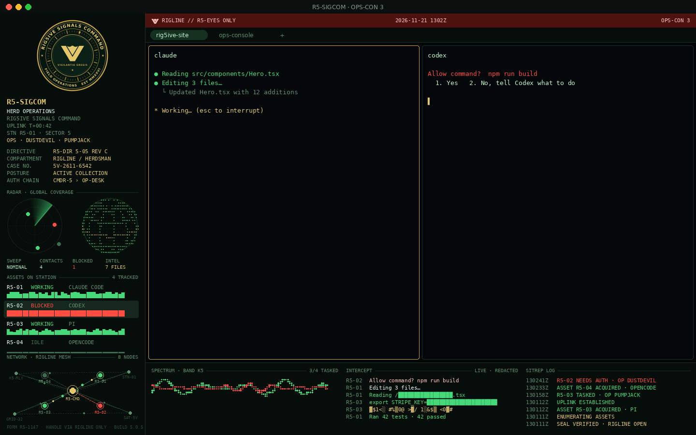

# R5-SIGCOM

A signals-intelligence ops console for your agents, from a fictional agency, Rig5ive Signals Command. A brass command seal, radar and asset roster run down the left. Over the terminals sit a red or green classification banner and a scrolling GDP ticker. Along the bottom are a spectrum analyzer, a redacted intercept feed, a fake treasury desk and a SITREP log. A dossier panel on the right gives each agent a codename and a plain-language alert. Everything moves with agent status: dark when no agents run, a boot sequence when the first one starts, red when one needs approval.

## What you see

Theme `r5-sigcom`: phosphor green on near-black, with brass accents. Font: JetBrains Mono 13 for the terminals and the UI.
- Colors: canvas `#030506`, background `#05080A`, chrome `#070D0A`, surface `#0A1410`, border `#1B3326`, text `#BFF5CF`, muted `#5E8F6E`, dim `#3E6B4F`.
- Accent / brass: `#C9A445`, with a highlight gold of `#E3C76A`.
- Status: working `#46D97A`, blocked `#FF4D42`, done `#6FB7FF`, idle `#3E6B4F`.

Left to right, top to bottom:

- **Command rail** (left, 300px, resizable 260–420):
  - **Seal**, about 160px: three stacked SVGs.
    - Outer ring with circular lettering: RIG5IVE SIGNALS COMMAND on top, FIELD OPERATIONS · EST MMXXVI on the bottom.
    - Tick ring.
    - Brass V-chevron emblem with the motto VIGILANTIA GREGIS.
    - Below 1150px window height it shrinks to a compact seal.
  - **Identity block:** R5-SIGCOM / HERD OPERATIONS / RIG5IVE SIGNALS COMMAND / UPLINK T+mm:ss / STN R5-01 · SECTOR 5 / OPS · two codenames.
  - **Routing card:** DIRECTIVE R5-DIR 5-05 REV C, COMPARTMENT RIGLINE / HERDSMAN, CASE NO. 5V-YYMM-NNNN, POSTURE, AUTH CHAIN CMDR-5 › OP-DESK.
  - **Radar** (≈120px scope):
    - A rotating sweep wedge, with one dot per agent in its status color.
    - Beside it: SWEEP, CONTACTS, BLOCKED, INTEL (n FILES, counted from git changes).
  - **Assets on station:**
    - One row per agent: R5-0n, STATUS, UNIT (agent name), and a block-character activity meter under it.
    - A blocked row gets a red tinted background.
  - **Network · Rigline mesh:**
    - Agents ring a central R5-CMD hub.
    - Four relay stations sit in the corners: K5-RLY, STN-01, GRID-32 and SAT-5V.
    - Links are dashed lines. Small packets travel along active links.
  - **Footer:** FORM R5-1147 · HANDLE VIA RIGLINE ONLY · BUILD.
  - **OPEN BROWSER** button.
- **Banner** (28px):
  - Left: classification text — RIGLINE // STANDBY, // HANDSHAKE, or // R5-EYES ONLY.
  - Center: date and Zulu time.
  - Right: OPS-CON n.
  - The background is dim olive when dormant, amber during boot, green when active and red when any agent is blocked.
- **Ticker** (22px):
  - ECON INTEL ▸ label, then a marquee: `USA  GDP $30.77T  ▲2.2%  ·  CHN …`.
  - WORLD BANK · year on the right.
- **Tabs** (38px): Herdr's tab bar, plus a **Dossier** button (the R5 mark icon) next to the Files and Changes buttons.
- **Terminals:** 6px padding and gap, 4px radius. Each pane has a 1px `#1B3326` border, which turns brass on focus. A 30px pane header sits on top.
- **Right panel** (hidden by default, 368px, 280–900). It is a stack of Files, Changes and Dossier.
- **Signals floor** (bottom, 150px, resizable 90–320). Columns left to right:
  - **Spectrum · Band K5:**
    - An AUD lane: a 3-row streaming waveform drawn with ▁ ─ ▔.
    - 4 rows of block-character bars (▁…█), with a 2-row dimmed reflection.
    - A dB axis on the left (0 / -12 / -24) and frequency labels underneath (60 · 250 · 1K · 4K · 16K).
    - Per-agent channel meters on the right (CH-n).
    - Header: n/m TASKED.
  - **Intercept** (when wider than 640px): up to 6 lines of `R5-0n  text`, header LIVE · REDACTED.
  - **Treasury** (when wider than 1150px):
    - Three accounts: OPERATIONS, RESERVE and FIELD EXP., each with a fake routing number and a balance.
    - A TOTAL line.
    - A 3-line transaction log (WIRE OUT, ACH IN…). Header: SIM.
  - **SITREP log:** Zulu-stamped lines such as `130241Z R5-02 NEEDS AUTH · OP DUSTDEVIL`, colored by event.

## How it behaves

- **Dormant (no agents):**
  - The banner says STANDBY and the seal is dimmed.
  - Assets say NO ASSETS ON STATION · AWAITING TASKING.
  - The spectrum is a flat carrier line with a slow pulse. The intercept shows `-- KEEPALIVE ACK --`.
- **Boot:**
  - Starts when the first agent appears and lasts 3.4 seconds.
  - Six phases at 0 / 500 / 1100 / 1700 / 2300 / 2900ms: seal verified, keys exchanged, auth, tasking signal, uplink, platform online.
  - The banner goes amber (HANDSHAKE) and the intercept shows scrolling hex SYNC lines.
- **Active:**
  - OPS-CON goes from 5 to 1 as more agents work.
  - The window title is `R5-SIGCOM · OPS-CON n`, and the dock badge shows the blocked count.
  - Each agent gets a stable asset number and a codename from a fixed list (NIGHTJAR, PUMPJACK, DUSTDEVIL, …).
- **Statuses:**
  - **Working:** green dot, moving meter, spectrum energy.
  - **Blocked:** red row, red spikes in the spectrum, the banner turns red, and the alert reads NEEDS AUTHORIZATION, pulsing.
  - **Done:** blue, MISSION COMPLETE · REVIEW.
  - **Idle:** dim, STANDING BY, flat meter.
  - Status changes are written to the SITREP log.
- **Intercept:**
  - Every 6s it reads the last lines of up to 3 working or blocked agents. It skips the focused agent.
  - It strips escape codes and TUI chrome.
  - It blacks out with █ any API keys, tokens, emails, long hashes and home paths.
  - Clicking the INTERCEPT header pauses or resumes it (PAUSED).
- **Dossier:**
  - Clicking an asset row, or the tab-bar Dossier button, shows the right panel on the Dossier.
  - The card shows:
    - the agent's logo on a brass-cornered plate (its initials if it has no icon)
    - the alert box
    - CLEARANCE R5-HERDSMAN · FORM R5-2290
    - CALLSIGN, OPERATION, UNIT, STATUS, THEATER (space), POSITION (redacted cwd), BRANCH, TIME ON TASK, INTEL (files changed)
    - LAST TRAFFIC · REDACTED (last 3 lines)
    - CLOSE and GO TO TERMINAL (`agent.focus`) buttons
  - The panel follows the focused agent, or stays on one you clicked.
- **Right-click a tab:** a menu with Split right, Split down, New agent in split (each installed agent), Rename, Close and More….
- **Right-click a folder** (or the Files header): Start agent here (each installed agent; new tab, split right or split down), and Reveal in Finder.
- **OPEN BROWSER:** if `terminal-browser` is on PATH, it opens in a right split. Otherwise a toast explains how to install it.
- **Treasury:** balances drift and return to base, and the transaction log scrolls.
- **GDP ticker:** cycles USA, CHN, DEU, JPN, IND, GBR, FRA… with ▲/▼ growth figures.

## Built from

- **Layout `layouts/r5-sigcom.json`:**
  - root row: `rail` (block, px 300) + `work` column.
  - `work` column, top to bottom:
    - `banner` (px 28)
    - `ticker` (px 22)
    - `tabs` (px 38, mod `r5-tabs`)
    - `work-body`, a row with padding 6 and gap 6. It holds `main` (tab active; pane header mod `pane`, height 30) and `panel` (hidden column, px 368). `panel` contains `panel-body`, a stack of `files` (mod `r5-files`), `changes` (shipped mod `changes`) and `dossier`.
    - `feed` (px 150)
  - Root settings: `theme: r5-sigcom`, `font: JetBrains Mono`, `font_size: 13`, `preview: layouts/r5-sigcom.png`.
- **Theme `themes/r5-sigcom.json`:** the colors above, plus 16 ANSI colors.
- **Mod `r5-sigcom`** (`mod.json` `{"place":"none"}`) is one View with `props.role` set to one of:
  - `rail`, `banner` (also runs the state machine on a 400ms tick and writes shared `r5.state` / `r5.log`), `ticker`, `feed`
  - `dossierpanel`
  - `tabmenu` and `filemenu`: popups opened with `openOverlay({mod:"r5-sigcom", kind:"popup", …})`
- **Mod `r5-tabs`:** a clone of the shipped `tabs` mod.
  - Right-click opens the `tabmenu` popup (300×470).
  - Adds `panelButton("dossier", "Dossier", "mods/r5-sigcom/mark.svg")`.
- **Mod `r5-files`:** a clone of the shipped `files` mod. Right-click on rows and on the header opens the `filemenu` popup.
- **herdr functions:** `agents`, `spaces`, `panes`, `focused`, `layout`, `window`, `knownAgents`, `shared`/`setShared`, `setBadge`, `setWindowTitle`, `notify`, `openOverlay`/`closeOverlay`, `hc(["read", address, "--lines", n])`.
- **Commands:** `pane.split {direction, pane, argv}`, `terminal.open {argv, folder, place}`, `tab.select`, `tab.rename`, `tab.close`, `layout.show`/`layout.hide`/`layout.select {stack:"panel-body", child}`, `agent.focus`.
- **Animation:**
  - Everything moving uses native `.frames(list, ms)`, `.loop(prop, …)` or svg `.spin(ms)`. This includes the ticker (140ms), spectrum (110–120ms), meters, treasury, boot text and hex.
  - Frames are precomputed on timers, never in `render`.
  - Mesh links are drawn with `window.paint_path(PathBuilder.stroke(1).dash_array(…))`.
- **Programs it runs:**
  - `curl` to `api.worldbank.org`: indicators NY.GDP.MKTP.CD and NY.GDP.MKTP.KD.ZG, once a day, cached in shared state. Built-in 2025 figures cover being offline.
  - `git status --porcelain` in agent folders.
  - `<shell> -lc "command -v terminal-browser"`.
  - `open -R` (Reveal in Finder).
  - `r5-files` also runs `sh`/`git` to list folders, like the shipped mod.
- **Art in `mods/r5-sigcom/`:** `seal-rings.svg`, `ticks.svg`, `seal-core.svg`, `mark.svg`, `radar-grid.svg`, `radar-sweep.svg`. Spin the sweep and the outer ring.

## Watch out

- **Network and programs:** the GDP fetch is the only network call. It reads agent screens (`hc read`) and runs the programs listed above. It reads nothing outside agent folders and its own.
- **Install the theme too:** copy `themes/r5-sigcom.json` along with the layout and mods. Without it the layout falls back to default colors.
- **Line height:** `.line_height(16)` is a multiplier. Use the string `"16px"`, or stacked strips overlap and vanish.
- **Fonts:** braille glyphs don't render in the mod UI font. Use block elements (▁…█ ▀ ▔) and box drawing (─ │).
- **Alignment:** `h_flex` centers children by default. Add `.items_start()` to feed columns.
- **Popups:** popups size to their content. `flex_1`/`min_h(0)` inside a popup collapses it to nothing.
- **Re-render cost:** heavy work in `render` gets the view interrupted ("could not be re-rendered"). Compute frames on timers.
- **Intercept cost:** reading the focused agent's screen, or polling faster than a few seconds, makes typing lag.
- **Panel ids:** the panel ids `panel`, `panel-body`, `files` and `changes` must match what the tab bar's panel buttons expect, or `layout.show` fails.
- **Limits:**
  - The mesh fits about 6 agents around the hub. Asset meters show the first 8.
  - The treasury needs a feed wider than 1150px, and the intercept one wider than 640px.
- **Reveal in Finder** on macOS; on Linux the same menu item is "Open in file manager" (`xdg-open`).
- **Fictional:** all codes, stations and money are fictional. Use no real agency seals or names.

## Done when

- With no agents, the banner reads RIGLINE // STANDBY and assets say AWAITING TASKING.
- Starting one agent runs the amber boot sequence, then a green active banner with OPS-CON and an R5-01 asset row.
- A blocked agent turns its row and the banner red, shows NEEDS AUTHORIZATION in its dossier, and puts a blocked count on the dock badge.
- The spectrum bars move while an agent works and fall to a flat pulsing carrier when none do.
- Intercept lines appear for a busy background agent with secrets shown as █. Clicking INTERCEPT shows PAUSED.
- The tab-bar Dossier button opens the right panel, and GO TO TERMINAL focuses that agent.
- Right-clicking a tab and choosing Split right opens a split. Right-clicking a folder and starting an agent opens it in that folder.
- The ticker scrolls GDP figures and the treasury balances tick.
- `herdr-app check` passes for `r5-sigcom`, `r5-tabs` and `r5-files`.
